<div align="center">

# 📅 USOS Widget for iPhone

**Your USOS timetable on the home screen and lock screen — for students of any university that uses USOSweb.**

**English** · [Polski](README.pl.md) · [Українська](README.uk.md) · [Русский](README.ru.md)

[](https://github.com/ProstoKery/usos-widget-ios/actions/workflows/test.yml)


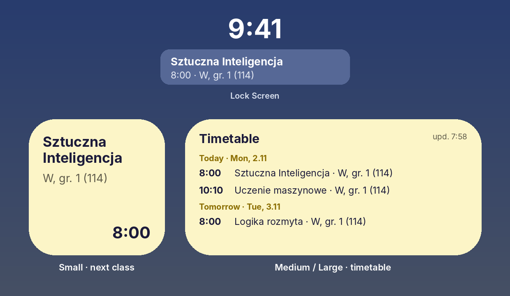

Runs inside the free app **Scriptable** — nothing to buy, no Mac needed.

Have Android? → **[USOS Widget for Android](https://github.com/ProstoKery/usos-widget-android)**

</div>

---

## ✨ What it does

- 🕗 **Small widget** — your current or next class: course, type, group, room and time.
- 🗓 **Medium / large widget** — all upcoming classes, grouped by day.
- 🔒 **Lock screen widget** — the next class right under the clock.
- 🔔 **Change alerts** — a notification when a class in the next 7 days is **moved, cancelled, added or changes room**.
- 🌍 **Your language** — Polski, English, Українська, Русский (follows the phone).
- 🔐 **No login** — never asks for your password. It uses the private calendar link from USOSweb.

## 📲 Setup — about 5 minutes

### Step 1. Install Scriptable

Open the App Store, find **[Scriptable](https://apps.apple.com/app/scriptable/id1405459188)** (free, by Simon B. Støvring) and tap **Get**.

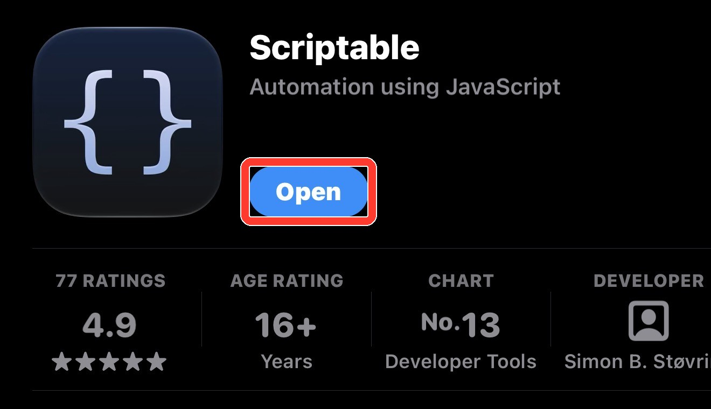

### Step 2. Copy your timetable link from USOSweb

Do this on the iPhone, in Safari. The screenshots show one university's USOSweb — yours looks the same or very similar.

1. Open your university's USOSweb (for example **usosweb.uw.edu.pl** or **usosweb.vistula.edu.pl**) and tap **Zaloguj się**. Sign in with your university account.

2. At the top open **MÓJ USOSWEB**, then on the left **PLAN ZAJĘĆ**. If you don't see the top menu, tap **☰** or turn the phone sideways.

   

3. Tap **eksportuj** in the top-right corner.

   

4. The **Eksport planu zajęć** window opens. Tap the copy button next to the link. The link contains `/services/tt/upcoming_ical?`

   

> 🔒 Anyone with this link can see your timetable. Don't post it in group chats.

### Step 3. Add USOS Widget to Scriptable

1. Copy this code — tap the copy icon in the top-right corner of the box:

   ```js
   const url = "https://raw.githubusercontent.com/ProstoKery/usos-widget-ios/main/UsosWidget.js";
   let fm = FileManager.local();
   try { const ic = FileManager.iCloud(); if (ic.isFileStoredIniCloud(module.filename)) fm = ic; } catch (e) {}
   const code = await new Request(url).loadString();
   if (!code.includes("USOS Widget")) throw new Error("Download failed — check the internet and try again.");
   fm.writeString(fm.joinPath(fm.documentsDirectory(), "USOS Widget.js"), code);
   Safari.open("scriptable:///run/" + encodeURIComponent("USOS Widget"));
   ```

   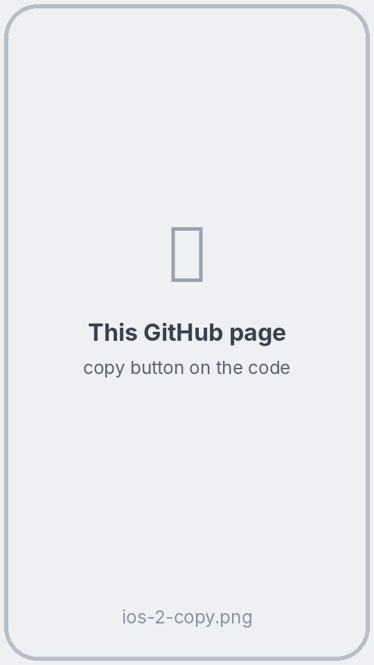

2. Open **Scriptable** → tap **+** in the top-right corner → tap the empty page → **Paste**.

   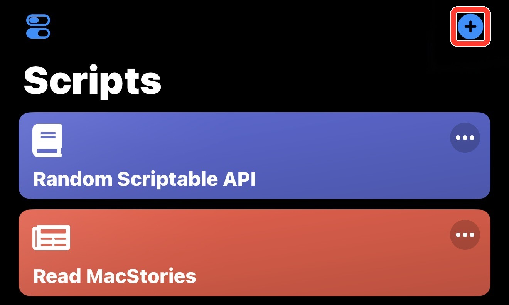

3. Tap **▶** in the bottom-right corner. This downloads **USOS Widget** and starts it. If nothing opens, tap **Done**, then tap **USOS Widget** in the script list.

   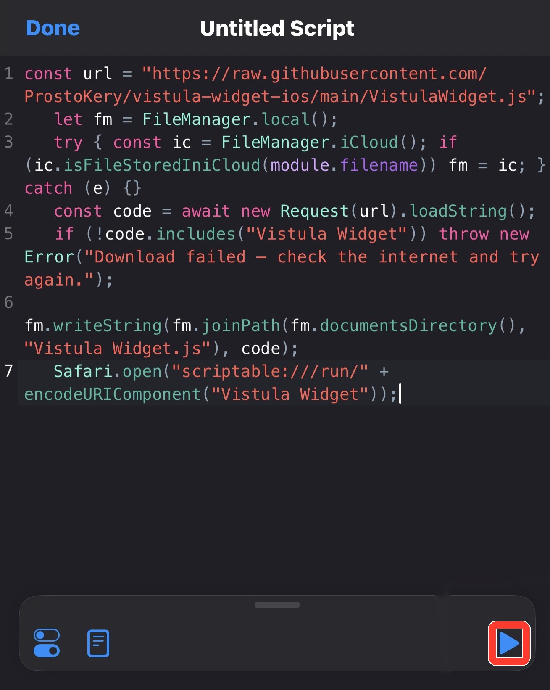

### Step 4. Paste your link

A window **Your USOS link** appears. Tap the field → **Paste** → **Save**. You'll see the list of your classes.

When Scriptable asks to send notifications, tap **Allow** — that's how you'll hear about timetable changes.

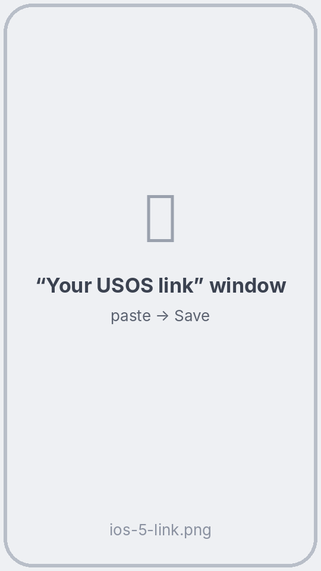 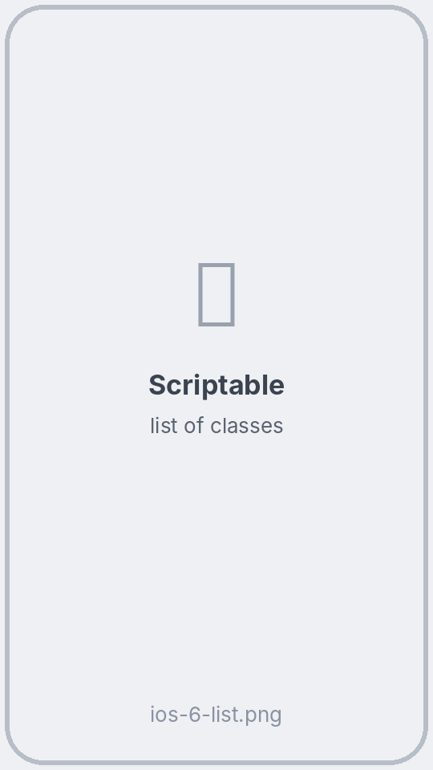

### Step 5. Add the widget

1. On the home screen, hold an empty spot until the icons jiggle. Tap **Edit** in the top-left corner (on older iOS: **+**) → **Add Widget**.
2. Find **Scriptable** and pick a size: **small** = next class, **medium** or **large** = timetable → **Add Widget**.

   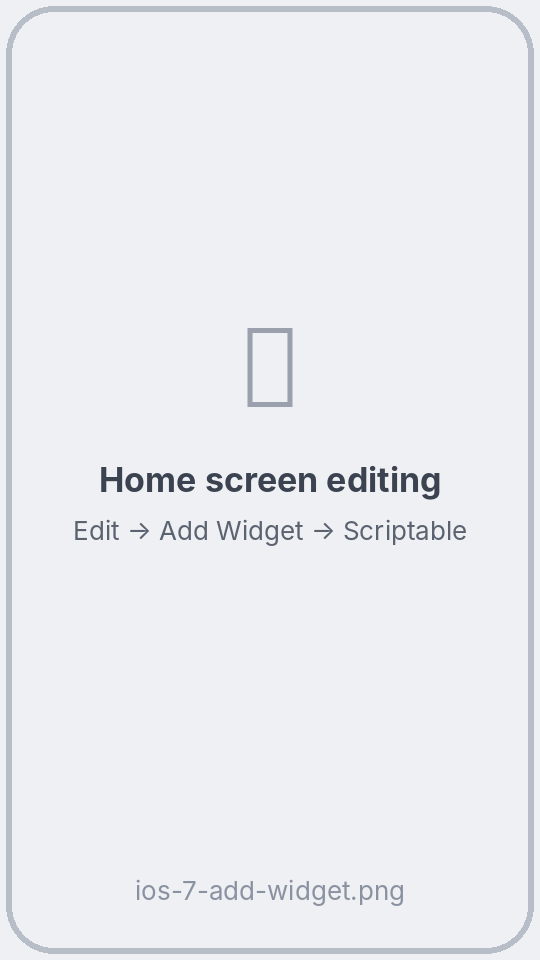

3. Hold the new widget → **Edit Widget** → **Script** → **USOS Widget**. Tap outside the window.

   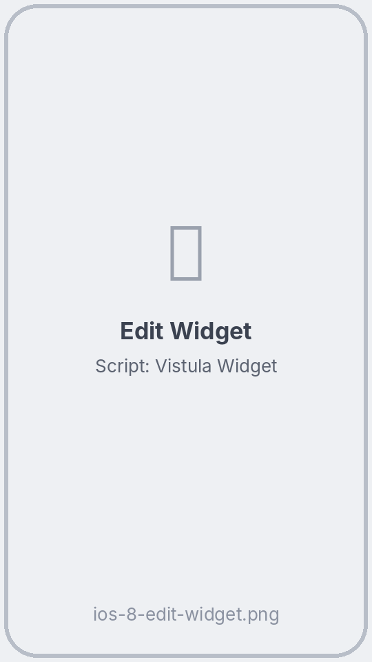 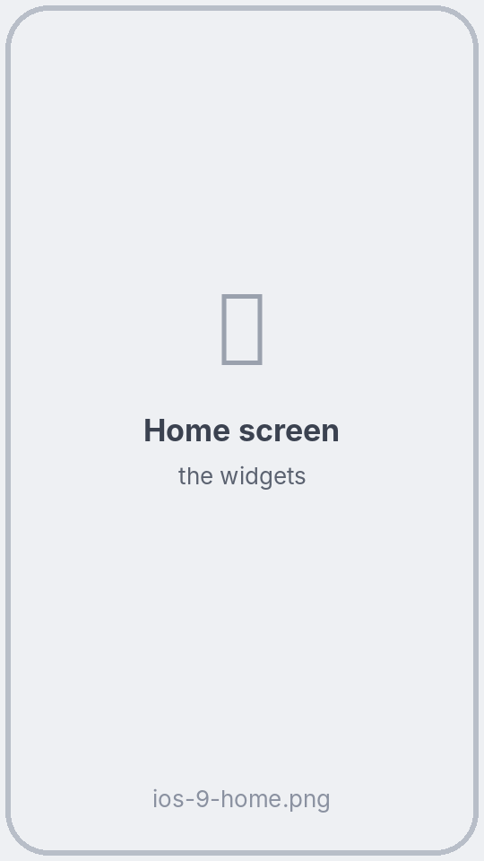

**Lock screen (optional):** hold the lock screen → **Customize** → **Lock Screen** → tap the area under the clock → **Scriptable** → pick a widget → tap it → **Script: USOS Widget**.

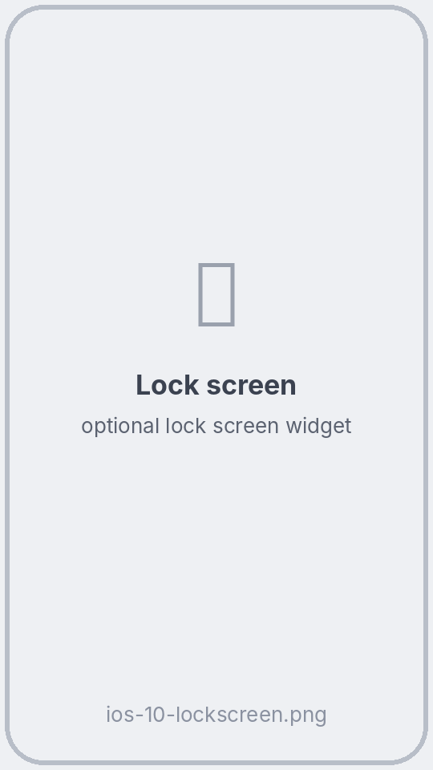

> You can delete the installer now: in Scriptable swipe left on **Untitled Script** → **Delete**. Or keep it and run it again later to update USOS Widget.

## 🔄 How the widget updates

On iPhone, **iOS decides when widgets refresh**, not the script. Apple says a widget you look at often gets roughly **40–70 refreshes a day — about every 15 to 60 minutes**. Looking at the widget doesn't refresh it on the spot, but iOS gives more refreshes to widgets you see often.

| What | When |
|---|---|
| New data from USOS | When iOS refreshes the widget, but no more than once every 30 minutes (to spare USOS and your battery) |
| The next class switches | The script asks iOS to refresh right when a class starts or ends. iOS usually does it soon after, but it may be late |
| Right now | **Tap the widget** — Scriptable opens, downloads the timetable and shows the list |
| Change notification | After a refresh finds a class in the next 7 days moved, cancelled, added or in another room |

## ❓ FAQ

**The widget says “Tap and paste your USOS link”.** Do step 4: tap the widget and paste the link.

**The widget still shows a class that has ended.** iOS hasn't refreshed it yet. Tap the widget to refresh now.

**How do I change the link?** Tap the widget (or open **USOS Widget** in Scriptable) → at the bottom of the list tap **🔗 Change USOS link**.

**How do I update USOS Widget?** Run the installer from step 3 again. Your link stays saved.

**The widget says “No connection to USOS”.** Check the internet. USOS may also be down for a while — the last timetable stays on the widget.

**How do I change the language?** It follows the iPhone language (Polish, English, Ukrainian, Russian; anything else → English).

## 🔒 Privacy

- The script talks only to your university's USOS server — the address in your link. No accounts, no analytics, no ads.
- Your link is stored in the iPhone keychain through Scriptable and never leaves the phone.

## 🛠 For developers

- Everything is in [`UsosWidget.js`](UsosWidget.js); [`install.js`](install.js) is the installer from step 3.
- [`test/scriptable-sim.mjs`](test/scriptable-sim.mjs) runs the script in Node with a fake Scriptable API: first-run setup, every widget size, lock screen widgets, four languages, change notifications, a wrong link and changing the link. Run it with `node test/scriptable-sim.mjs` (no dependencies). GitHub runs it on every push.

## ⚠️ Disclaimer

An unofficial student project, not affiliated with the USOS team (MUCI), any university or Scriptable. Tested at Vistula University; it should work wherever USOSweb lets you export your timetable.

## 📄 License

[MIT](LICENSE) © 2026 Kyrylo Serhiienko
