<div align="center">

# 📅 USOS Widget na iPhone'a

**Twój plan zajęć z USOS na ekranie głównym i ekranie blokady — dla studentów każdej uczelni, która korzysta z USOSweb.**

[English](README.md) · **Polski** · [Українська](README.uk.md) · [Русский](README.ru.md)

[](https://github.com/ProstoKery/usos-widget-ios/actions/workflows/test.yml)


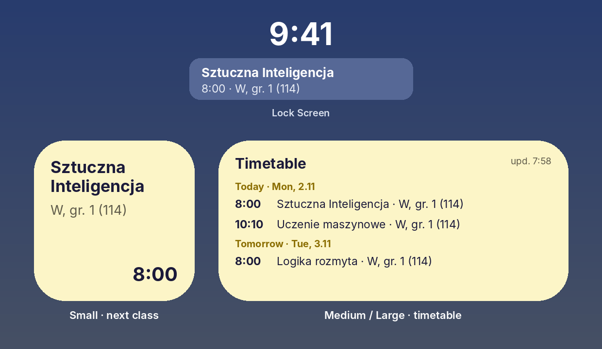

Działa w darmowej aplikacji **Scriptable** — nic nie kupujesz, Mac nie jest potrzebny.

Masz Androida? → **[USOS Widget na Androida](https://github.com/ProstoKery/usos-widget-android)**

</div>

---

## ✨ Co potrafi

- 🕗 **Mały widżet** — bieżące lub następne zajęcia: przedmiot, forma, grupa, sala i godzina.
- 🗓 **Średni / duży widżet** — wszystkie nadchodzące zajęcia, pogrupowane według dni.
- 🔒 **Widżet na ekranie blokady** — najbliższe zajęcia tuż pod zegarem.
- 🔔 **Powiadomienia o zmianach** — gdy zajęcia w ciągu najbliższych 7 dni zostaną **przeniesione, odwołane, dodane lub zmieni się sala**.
- 🌍 **Twój język** — Polski, English, Українська, Русский (zgodnie z językiem telefonu).
- 🔐 **Bez logowania** — nigdy nie pyta o hasło. Korzysta z prywatnego linku do kalendarza z USOSweb.

## 📲 Instalacja — około 5 minut

### Krok 1. Zainstaluj Scriptable

Otwórz App Store, znajdź **[Scriptable](https://apps.apple.com/app/scriptable/id1405459188)** (darmowa, autor: Simon B. Støvring) i dotknij **Pobierz**.

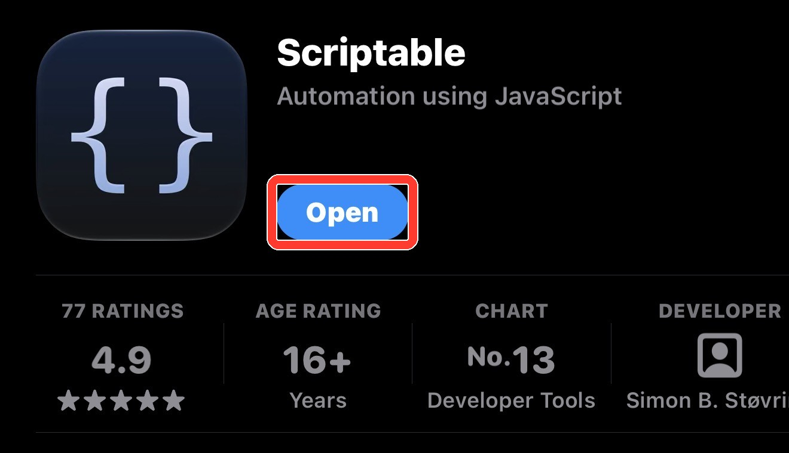

### Krok 2. Skopiuj link do swojego planu z USOSweb

Zrób to na iPhonie, w Safari. Zrzuty ekranu pochodzą z USOSweb jednej uczelni — u Ciebie wygląda tak samo lub bardzo podobnie.

1. Otwórz USOSweb swojej uczelni (np. **usosweb.uw.edu.pl** albo **usosweb.vistula.edu.pl**) i dotknij **Zaloguj się**. Zaloguj się kontem uczelnianym.

2. U góry otwórz **MÓJ USOSWEB**, a po lewej **PLAN ZAJĘĆ**. Jeśli nie widzisz górnego menu, dotknij **☰** albo obróć telefon poziomo.

   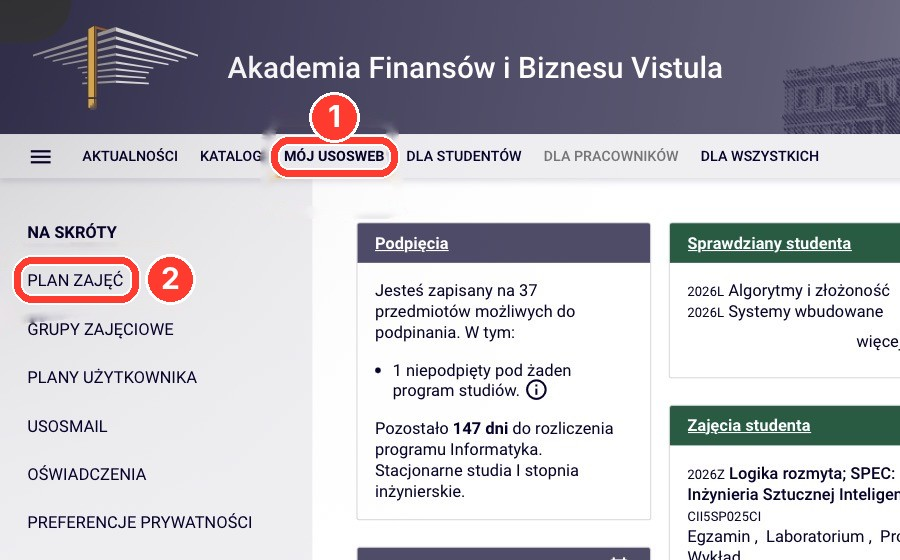

3. Dotknij **eksportuj** w prawym górnym rogu.

   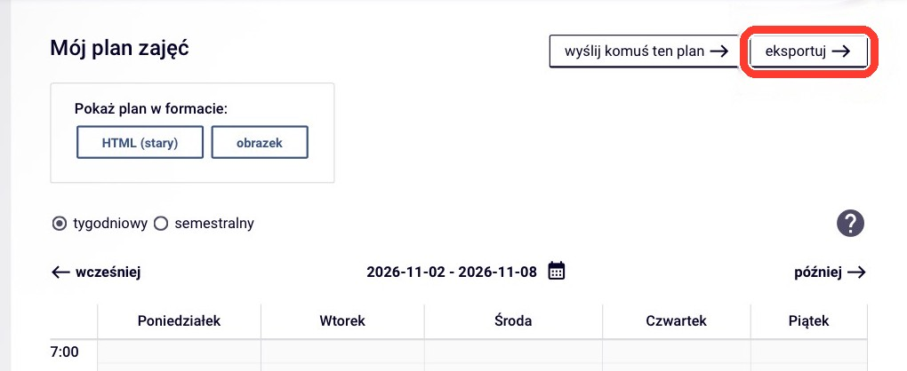

4. Otworzy się okno **Eksport planu zajęć**. Dotknij przycisku kopiowania obok linku. Link zawiera `/services/tt/upcoming_ical?`

   

> 🔒 Każdy, kto ma ten link, zobaczy Twój plan. Nie wrzucaj go na czaty grupowe.

### Krok 3. Dodaj USOS Widget do Scriptable

1. Skopiuj ten kod — dotknij ikony kopiowania w prawym górnym rogu ramki:

   ```js
   const url = "https://raw.githubusercontent.com/ProstoKery/usos-widget-ios/main/UsosWidget.js";
   let fm = FileManager.local();
   try { const ic = FileManager.iCloud(); if (ic.isFileStoredIniCloud(module.filename)) fm = ic; } catch (e) {}
   const code = await new Request(url).loadString();
   if (!code.includes("USOS Widget")) throw new Error("Download failed — check the internet and try again.");
   fm.writeString(fm.joinPath(fm.documentsDirectory(), "USOS Widget.js"), code);
   Safari.open("scriptable:///run/" + encodeURIComponent("USOS Widget"));
   ```

   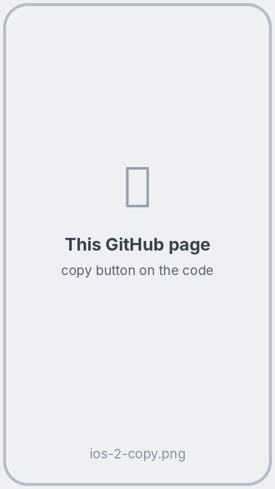

2. Otwórz **Scriptable** → dotknij **+** w prawym górnym rogu → dotknij pustej strony → **Wklej**.

   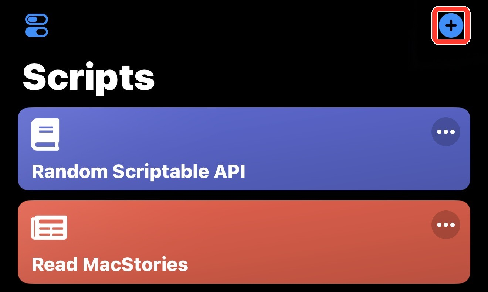

3. Dotknij **▶** w prawym dolnym rogu. Pobierze to **USOS Widget** i od razu go uruchomi. Jeśli nic się nie otworzy, dotknij **Done**, a potem **USOS Widget** na liście skryptów.

   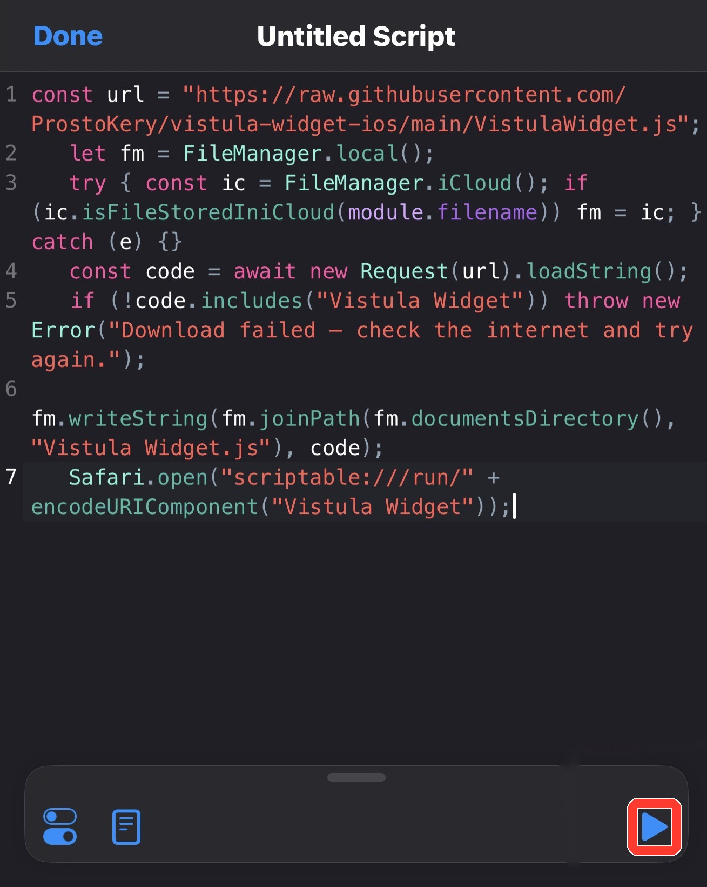

### Krok 4. Wklej link

Pojawi się okno **Twój link z USOS**. Dotknij pola → **Wklej** → **Zapisz**. Zobaczysz listę swoich zajęć.

Gdy Scriptable zapyta o powiadomienia, dotknij **Pozwalaj** — tak dowiesz się o zmianach w planie.

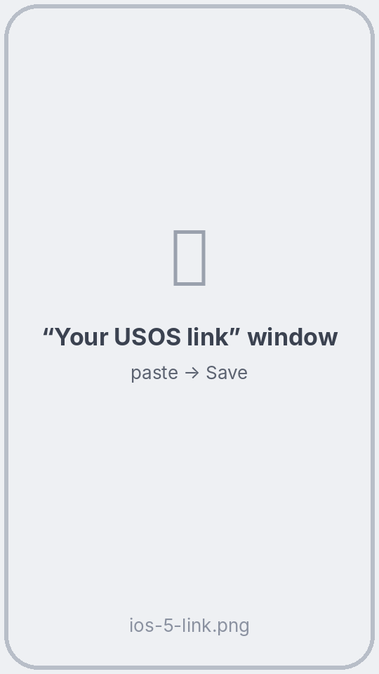 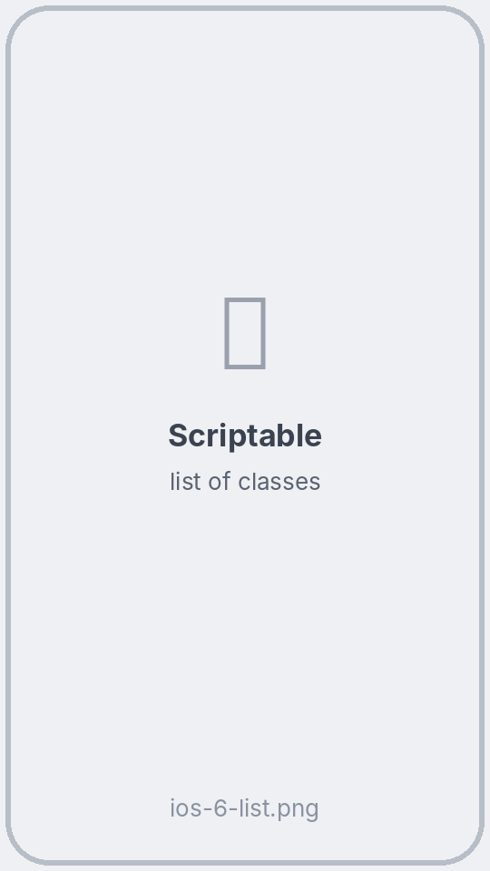

### Krok 5. Dodaj widżet

1. Na ekranie głównym przytrzymaj puste miejsce, aż ikony zaczną drgać. Dotknij **Edytuj** w lewym górnym rogu (w starszym iOS: **+**) → **Dodaj widżet**.
2. Znajdź **Scriptable** i wybierz rozmiar: **mały** = najbliższe zajęcia, **średni** lub **duży** = plan → **Dodaj widżet**.

   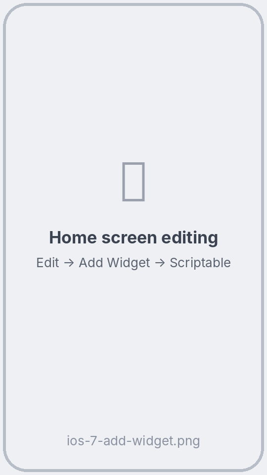

3. Przytrzymaj nowy widżet → **Edytuj widżet** → **Script** → **USOS Widget**. Dotknij poza oknem.

   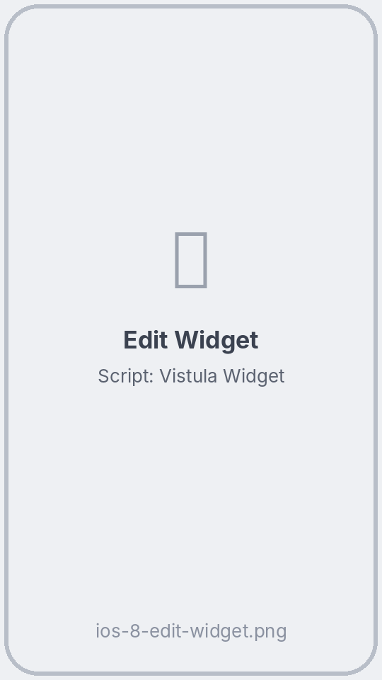 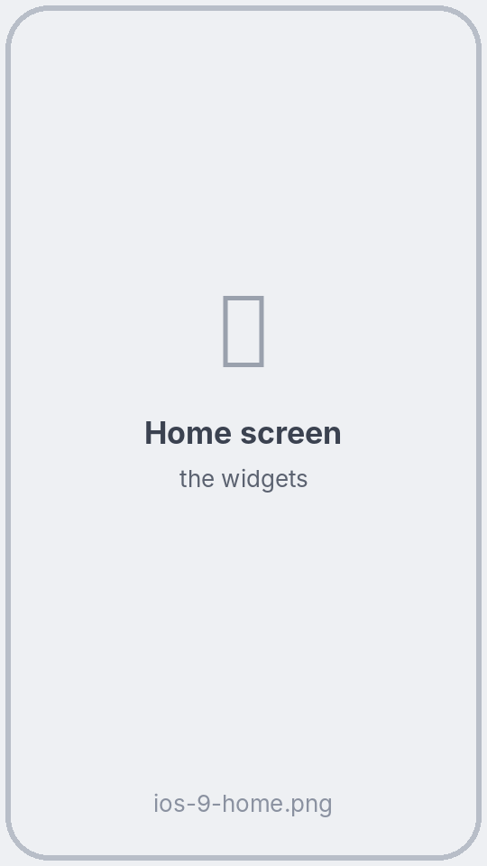

**Ekran blokady (opcjonalnie):** przytrzymaj ekran blokady → **Dostosuj** → **Ekran blokady** → dotknij miejsca pod zegarem → **Scriptable** → wybierz widżet → dotknij go → **Script: USOS Widget**.

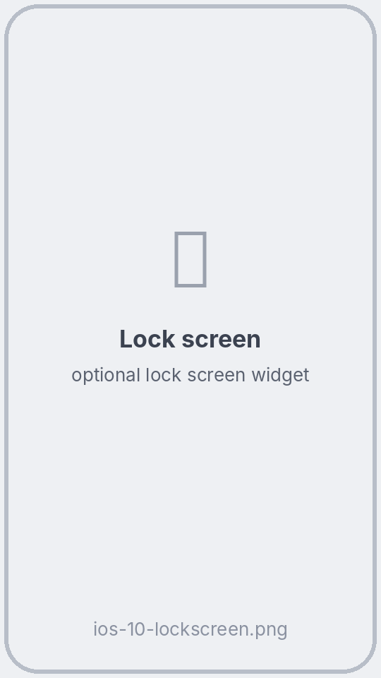

> Instalator możesz już usunąć: w Scriptable przesuń w lewo **Untitled Script** → **Delete**. Albo zostaw go, żeby później zaktualizować USOS Widget.

## 🔄 Jak widżet się aktualizuje

Na iPhonie **to iOS decyduje, kiedy odświeżyć widżet**, a nie skrypt. Według Apple widżet, na który często patrzysz, dostaje około **40–70 odświeżeń dziennie — mniej więcej co 15–60 minut**. Samo patrzenie nie odświeża widżetu od razu, ale iOS daje więcej odświeżeń widżetom, które często widzisz.

| Co | Kiedy |
|---|---|
| Nowe dane z USOS | Gdy iOS odświeża widżet, ale nie częściej niż co 30 minut (żeby oszczędzać USOS i baterię) |
| Przełączenie na następne zajęcia | Skrypt prosi iOS o odświeżenie dokładnie na początku i końcu zajęć. Zwykle dzieje się to wkrótce, ale może się spóźnić |
| Od razu | **Dotknij widżetu** — Scriptable się otworzy, pobierze plan i pokaże listę |
| Powiadomienie o zmianie | Po odświeżeniu, które wykryje, że zajęcia w ciągu 7 dni przeniesiono, odwołano, dodano lub zmieniono salę |

## ❓ Pytania

**Widżet pokazuje „Dotknij i wklej link z USOS”.** Zrób krok 4: dotknij widżetu i wklej link.

**Widżet wciąż pokazuje zajęcia, które już się skończyły.** iOS jeszcze go nie odświeżył. Dotknij widżetu, żeby odświeżyć teraz.

**Jak zmienić link?** Dotknij widżetu (albo otwórz **USOS Widget** w Scriptable) → na dole listy dotknij **🔗 Zmień link z USOS**.

**Jak zaktualizować USOS Widget?** Uruchom jeszcze raz instalator z kroku 3. Link zostaje zapisany.

**Widżet pokazuje „Brak połączenia z USOS”.** Sprawdź internet. USOS też czasem nie działa — na widżecie zostaje ostatni plan.

**Jak zmienić język?** Skrypt używa języka iPhone'a (polski, angielski, ukraiński, rosyjski; inne → angielski).

## 🔒 Prywatność

- Skrypt łączy się tylko z serwerem USOS Twojej uczelni — tym z Twojego linku. Bez kont, bez analityki, bez reklam.
- Twój link jest zapisany w pęku kluczy iPhone'a przez Scriptable i nie opuszcza telefonu.

## 🛠 Dla programistów

Opis kodu i testów: [README po angielsku](README.md#-for-developers).

## ⚠️ Zastrzeżenie

Nieoficjalny projekt studencki, niezwiązany z zespołem USOS (MUCI), żadną uczelnią ani Scriptable. Testowany w Uczelni Vistula; powinien działać wszędzie, gdzie USOSweb pozwala wyeksportować plan.

## 📄 Licencja

[MIT](LICENSE) © 2026 Kyrylo Serhiienko
