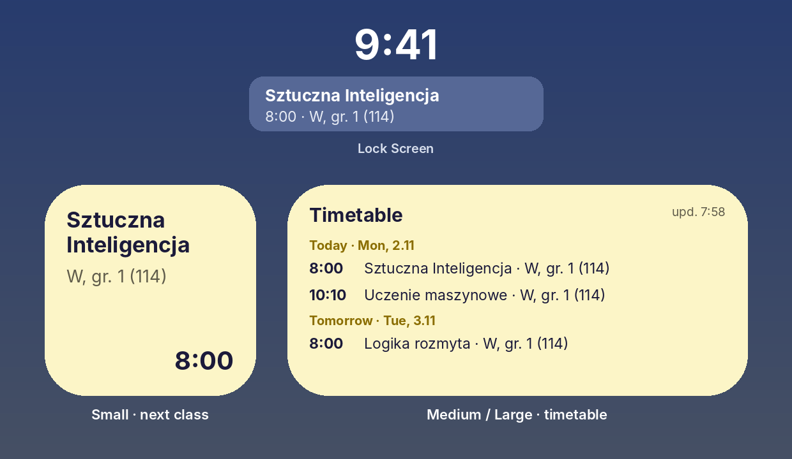
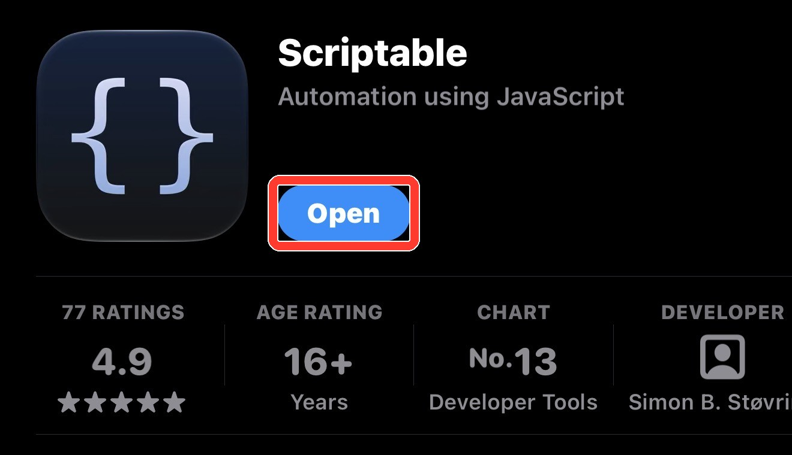
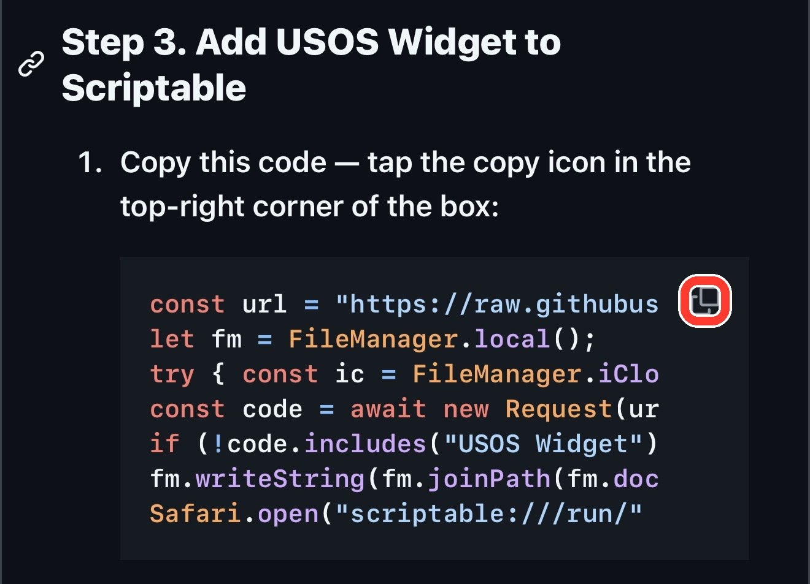
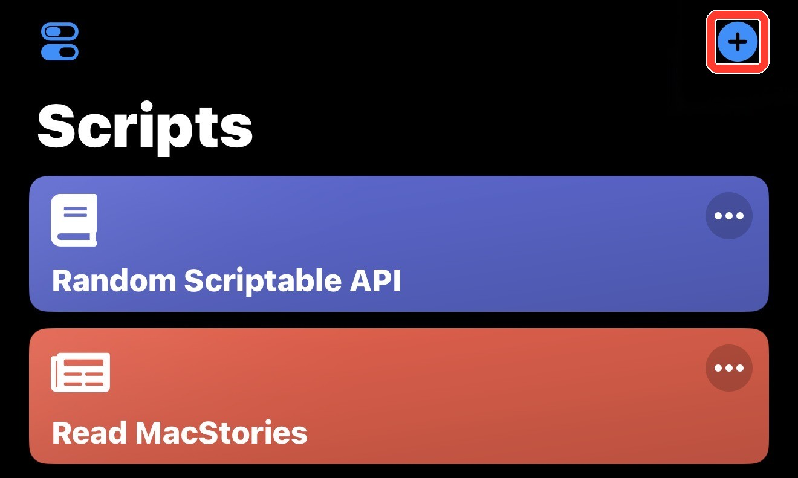
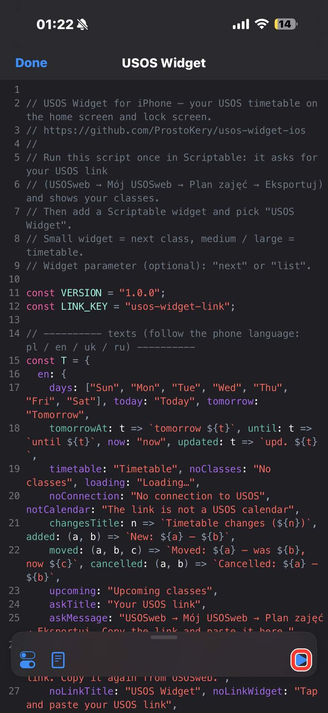
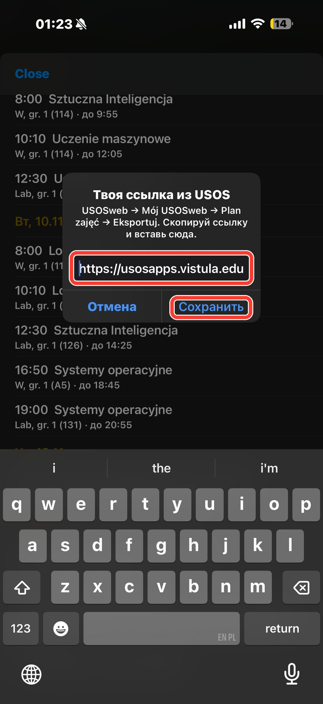
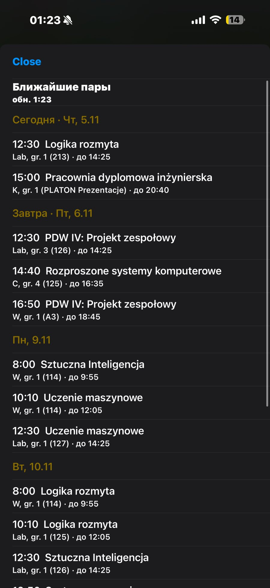
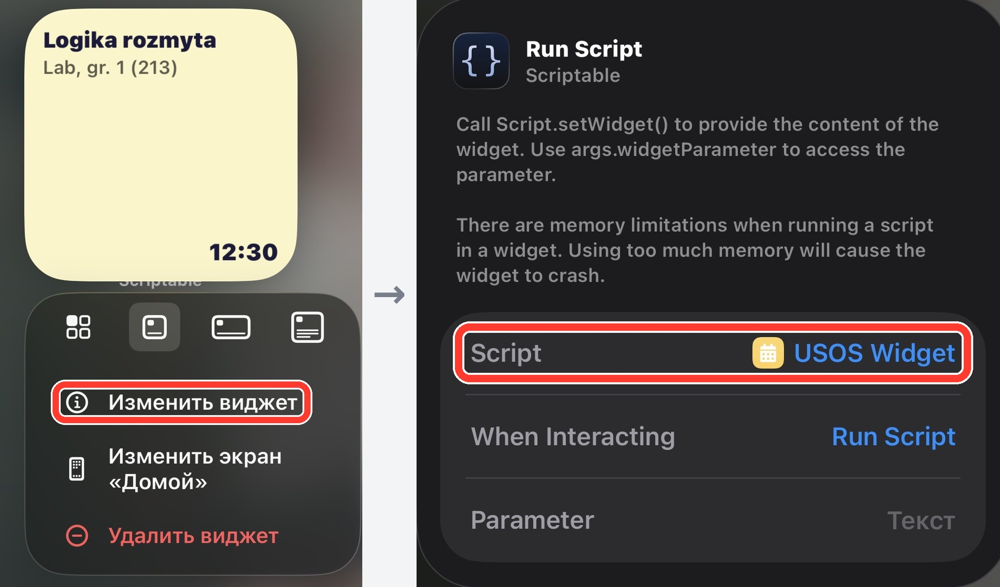
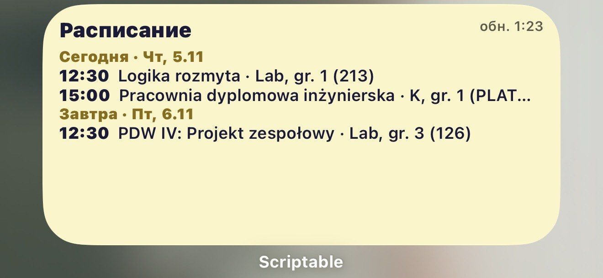

<div align="center">

# 📅 USOS Widget для iPhone

**Твоё расписание из USOS на рабочем столе и экране блокировки — для студентов любого вуза, где есть USOSweb.**

[English](README.md) · [Polski](README.pl.md) · [Українська](README.uk.md) · **Русский**

[](https://github.com/ProstoKery/usos-widget-ios/actions/workflows/test.yml)




Работает в бесплатном приложении **Scriptable** — ничего покупать не нужно, Mac не нужен.

Есть Android? → **[USOS Widget для Android](https://github.com/ProstoKery/usos-widget-android)**

</div>

---

## ✨ Что умеет

- 🕗 **Маленький виджет** — текущая или следующая пара: предмет, тип, группа, аудитория и время.
- 🗓 **Средний / большой виджет** — все ближайшие пары по дням.
- 🔒 **Виджет на экране блокировки** — ближайшая пара прямо под часами.
- 🔔 **Уведомления об изменениях** — когда пару в ближайшие 7 дней **перенесли, отменили, добавили или сменили аудиторию**.
- 🌍 **Твой язык** — Polski, English, Українська, Русский (как на телефоне).
- 🔐 **Без входа** — никогда не спрашивает пароль. Использует личную ссылку на календарь из USOSweb.

## 📲 Установка — около 5 минут

### Шаг 1. Установи Scriptable

Открой App Store, найди **[Scriptable](https://apps.apple.com/app/scriptable/id1405459188)** (бесплатный, автор Simon B. Støvring) и нажми **Загрузить**.



### Шаг 2. Скопируй ссылку на своё расписание из USOSweb

Делай это на iPhone, в Safari. Скриншоты сделаны в USOSweb одного вуза — у тебя он выглядит так же или очень похоже.

1. Открой USOSweb своего вуза (например **usosweb.uw.edu.pl** или **usosweb.vistula.edu.pl**) и нажми **Zaloguj się**. Войди университетским аккаунтом.

2. Сверху открой **MÓJ USOSWEB**, затем слева **PLAN ZAJĘĆ**. Если не видишь верхнего меню, нажми **☰** или поверни телефон горизонтально.

   

3. Нажми **eksportuj** в правом верхнем углу.

   

4. Откроется окно **Eksport planu zajęć**. Нажми кнопку копирования рядом со ссылкой. Ссылка содержит `/services/tt/upcoming_ical?`

   

> 🔒 Любой, у кого есть эта ссылка, увидит твоё расписание. Не кидай её в общие чаты.

### Шаг 3. Добавь USOS Widget в Scriptable

1. Скопируй этот код — нажми на значок копирования в правом верхнем углу рамки:

   ```js
   const url = "https://raw.githubusercontent.com/ProstoKery/usos-widget-ios/main/UsosWidget.js";
   let fm = FileManager.local();
   try { const ic = FileManager.iCloud(); if (ic.isFileStoredIniCloud(module.filename)) fm = ic; } catch (e) {}
   const code = await new Request(url).loadString();
   if (!code.includes("USOS Widget")) throw new Error("Download failed — check the internet and try again.");
   fm.writeString(fm.joinPath(fm.documentsDirectory(), "USOS Widget.js"), code);
   Safari.open("scriptable:///run/" + encodeURIComponent("USOS Widget"));
   ```

   

2. Открой **Scriptable** → нажми **+** в правом верхнем углу → нажми на пустую страницу → **Вставить**.

   

3. Нажми **▶** в правом нижнем углу. Это скачает **USOS Widget** и сразу его запустит. Если ничего не открылось, нажми **Done**, а потом **USOS Widget** в списке скриптов.

   

### Шаг 4. Вставь ссылку

Появится окно **Твоя ссылка из USOS**. Нажми на поле → **Вставить** → **Сохранить**. Ты увидишь список своих пар.

Когда Scriptable спросит про уведомления, нажми **Разрешить** — так ты будешь узнавать об изменениях в расписании.

 

### Шаг 5. Добавь виджет

1. На рабочем столе удерживай пустое место, пока иконки не начнут дрожать. Нажми **Править** в левом верхнем углу (в старых iOS: **+**) → **Добавить виджет**.
2. Найди **Scriptable** и выбери размер: **маленький** = ближайшая пара, **средний** или **большой** = расписание → **Добавить виджет**.

3. Удерживай новый виджет → **Изменить виджет** → **Script** → **USOS Widget**. Нажми за пределами окна.

   

   

**Экран блокировки (по желанию):** удерживай экран блокировки → **Настроить** → **Экран блокировки** → нажми на место под часами → **Scriptable** → выбери виджет → нажми на него → **Script: USOS Widget**.

> Установщик теперь можно удалить: в Scriptable проведи влево по **Untitled Script** → **Delete**. Или оставь его, чтобы потом обновить USOS Widget.

## 🔄 Как обновляется виджет

На iPhone **когда обновлять виджет, решает iOS**, а не скрипт. По словам Apple, виджет, на который ты часто смотришь, получает примерно **40–70 обновлений в день — где-то раз в 15–60 минут**. Сам взгляд не обновляет виджет мгновенно, но iOS даёт больше обновлений виджетам, которые ты часто видишь.

| Что | Когда |
|---|---|
| Новые данные из USOS | Когда iOS обновляет виджет, но не чаще раза в 30 минут (чтобы беречь USOS и батарею) |
| Переключение на следующую пару | Скрипт просит iOS обновиться ровно в начале и в конце пары. Обычно это происходит вскоре, но может опоздать |
| Прямо сейчас | **Нажми на виджет** — Scriptable откроется, скачает расписание и покажет список |
| Уведомление об изменении | После обновления, которое обнаружит, что пару в ближайшие 7 дней перенесли, отменили, добавили или сменили аудиторию |

## ❓ Вопросы

**Виджет пишет «Нажми и вставь ссылку из USOS».** Сделай шаг 4: нажми на виджет и вставь ссылку.

**Виджет всё ещё показывает пару, которая уже закончилась.** iOS его ещё не обновил. Нажми на виджет, чтобы обновить сейчас.

**Как поменять ссылку?** Нажми на виджет (или открой **USOS Widget** в Scriptable) → внизу списка нажми **🔗 Изменить ссылку USOS**.

**Как обновить USOS Widget?** Запусти ещё раз установщик из шага 3. Ссылка останется сохранённой.

**Виджет пишет «Нет связи с USOS».** Проверь интернет. USOS тоже иногда не работает — на виджете остаётся последнее расписание.

**Как поменять язык?** Скрипт использует язык iPhone (польский, английский, украинский, русский; остальные → английский).

## 🔒 Приватность

- Скрипт обращается только к серверу USOS твоего вуза — тому, что в ссылке. Без аккаунтов, аналитики и рекламы.
- Ссылка хранится в связке ключей iPhone через Scriptable и не покидает телефон.

## 🛠 Для разработчиков

Описание кода и тестов: [README на английском](README.md#-for-developers).

## ⚠️ Оговорка

Неофициальный студенческий проект, не связан с командой USOS (MUCI), каким-либо вузом и Scriptable. Проверен в университете Vistula; должен работать везде, где USOSweb позволяет экспортировать расписание.

## 📄 Лицензия

[MIT](LICENSE) © 2026 Kyrylo Serhiienko
