<div align="center">

# 📅 USOS Widget для iPhone

**Твій розклад з USOS на робочому столі та екрані блокування — для студентів будь-якого університету, що користується USOSweb.**

[English](README.md) · [Polski](README.pl.md) · **Українська** · [Русский](README.ru.md)

[](https://github.com/ProstoKery/usos-widget-ios/actions/workflows/test.yml)


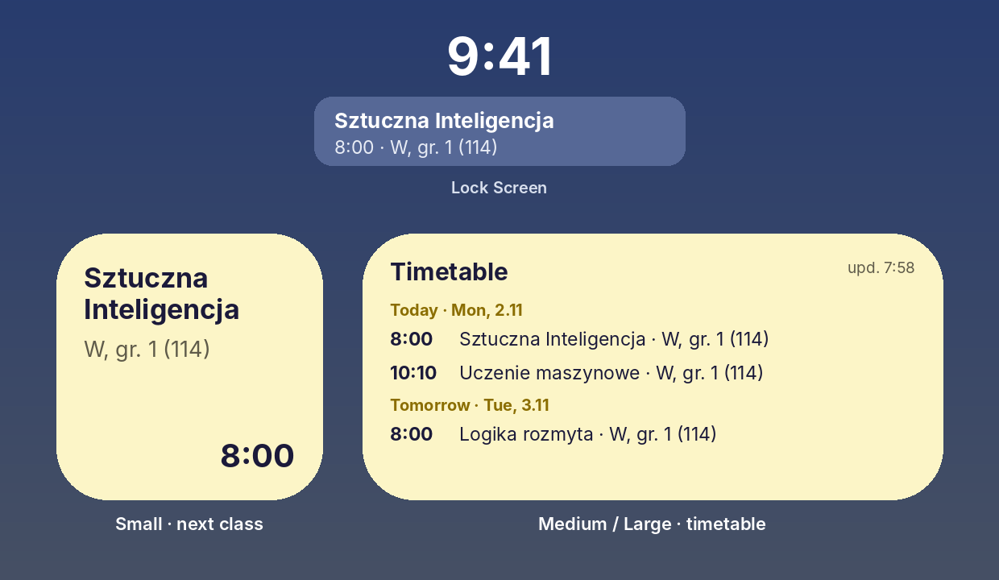

Працює в безкоштовному застосунку **Scriptable** — нічого не треба купувати, Mac не потрібен.

Маєш Android? → **[USOS Widget для Android](https://github.com/ProstoKery/usos-widget-android)**

</div>

---

## ✨ Що вміє

- 🕗 **Маленький віджет** — поточна або наступна пара: предмет, тип, група, аудиторія і час.
- 🗓 **Середній / великий віджет** — усі найближчі пари, згруповані за днями.
- 🔒 **Віджет на екрані блокування** — найближча пара просто під годинником.
- 🔔 **Сповіщення про зміни** — коли пару в найближчі 7 днів **перенесли, скасували, додали або змінили аудиторію**.
- 🌍 **Твоя мова** — Polski, English, Українська, Русский (як на телефоні).
- 🔐 **Без входу** — ніколи не питає пароль. Використовує приватне посилання на календар з USOSweb.

## 📲 Встановлення — близько 5 хвилин

### Крок 1. Встанови Scriptable

Відкрий App Store, знайди **[Scriptable](https://apps.apple.com/app/scriptable/id1405459188)** (безкоштовний, автор Simon B. Støvring) і натисни **Отримати**.

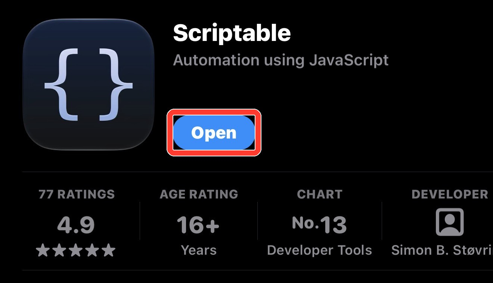

### Крок 2. Скопіюй посилання на свій розклад з USOSweb

Роби це на iPhone, у Safari. Скриншоти зроблені в USOSweb одного університету — у тебе він виглядає так само або дуже схоже.

1. Відкрий USOSweb свого університету (наприклад **usosweb.uw.edu.pl** або **usosweb.vistula.edu.pl**) і натисни **Zaloguj się**. Увійди університетським акаунтом.

2. Угорі відкрий **MÓJ USOSWEB**, потім ліворуч **PLAN ZAJĘĆ**. Якщо не бачиш верхнього меню, натисни **☰** або поверни телефон горизонтально.

   

3. Натисни **eksportuj** у правому верхньому куті.

   

4. Відкриється вікно **Eksport planu zajęć**. Натисни кнопку копіювання поруч із посиланням. Посилання містить `/services/tt/upcoming_ical?`

   

> 🔒 Кожен, у кого є це посилання, побачить твій розклад. Не кидай його в групові чати.

### Крок 3. Додай USOS Widget у Scriptable

1. Скопіюй цей код — натисни на значок копіювання у правому верхньому куті рамки:

   ```js
   const url = "https://raw.githubusercontent.com/ProstoKery/usos-widget-ios/main/UsosWidget.js";
   let fm = FileManager.local();
   try { const ic = FileManager.iCloud(); if (ic.isFileStoredIniCloud(module.filename)) fm = ic; } catch (e) {}
   const code = await new Request(url).loadString();
   if (!code.includes("USOS Widget")) throw new Error("Download failed — check the internet and try again.");
   fm.writeString(fm.joinPath(fm.documentsDirectory(), "USOS Widget.js"), code);
   Safari.open("scriptable:///run/" + encodeURIComponent("USOS Widget"));
   ```

   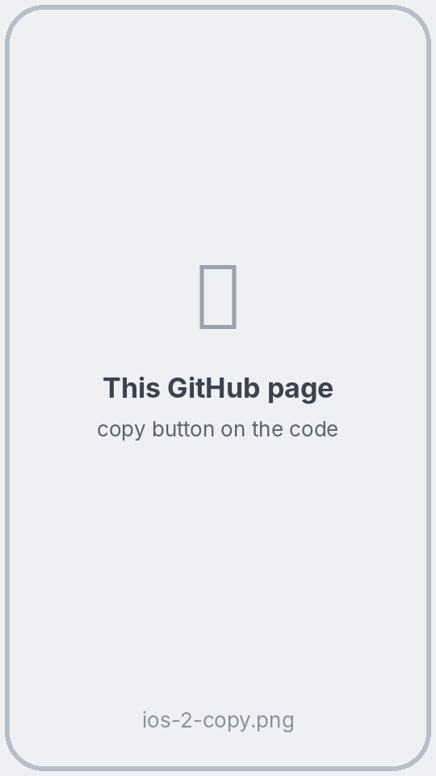

2. Відкрий **Scriptable** → натисни **+** у правому верхньому куті → натисни на порожню сторінку → **Вставити**.

   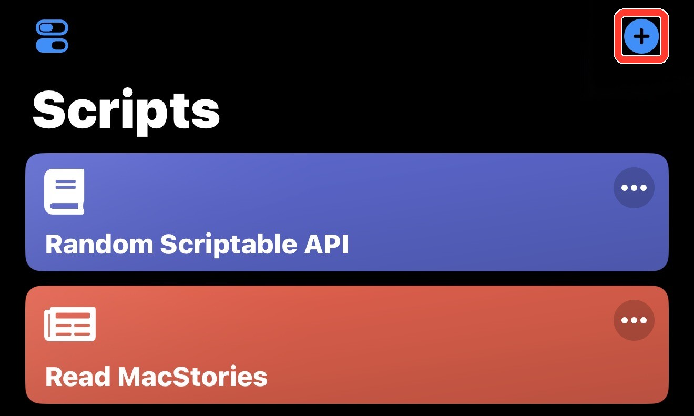

3. Натисни **▶** у правому нижньому куті. Це завантажить **USOS Widget** і одразу його запустить. Якщо нічого не відкрилося, натисни **Done**, а потім **USOS Widget** у списку скриптів.

   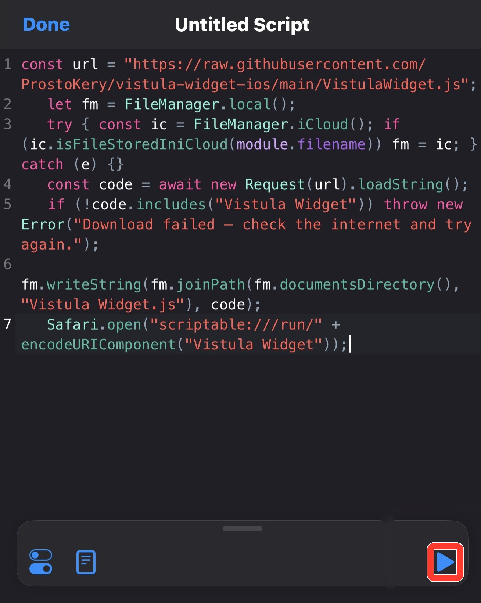

### Крок 4. Встав посилання

З'явиться вікно **Твоє посилання з USOS**. Натисни на поле → **Вставити** → **Зберегти**. Ти побачиш список своїх пар.

Коли Scriptable запитає про сповіщення, натисни **Дозволити** — так ти дізнаватимешся про зміни в розкладі.

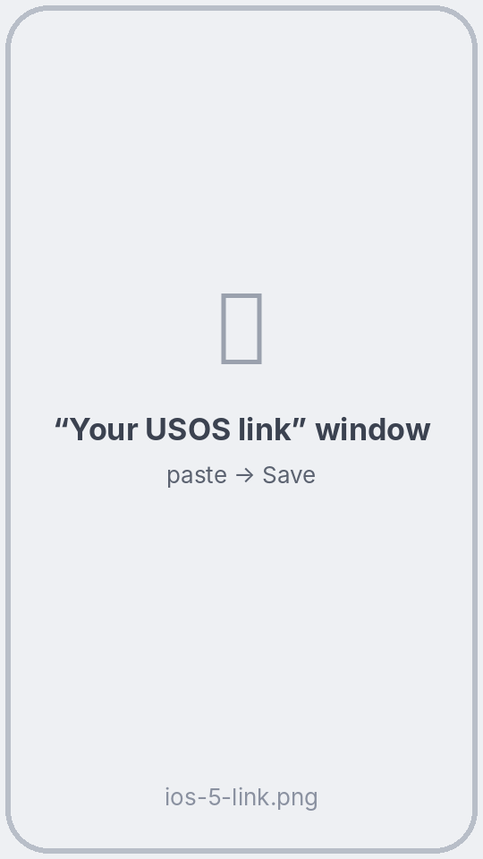 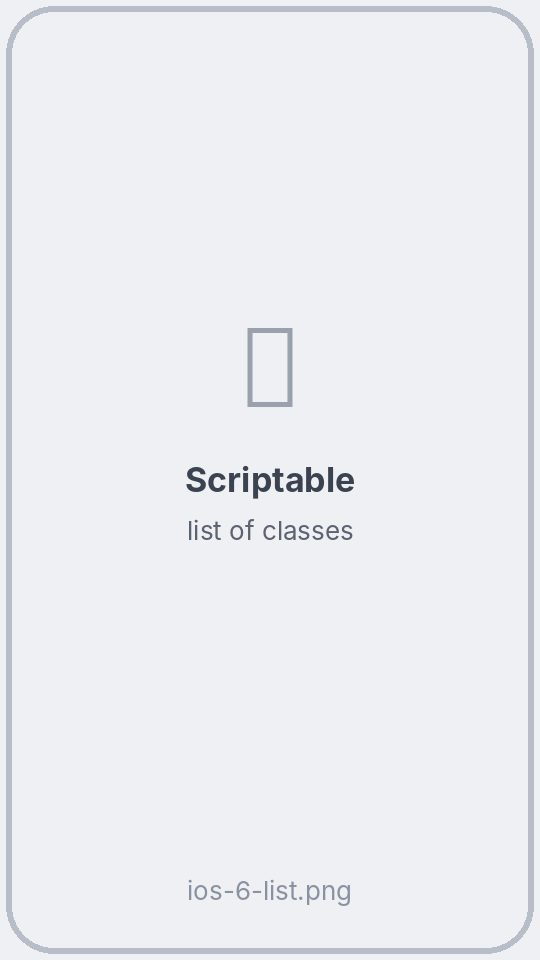

### Крок 5. Додай віджет

1. На робочому столі утримуй порожнє місце, доки іконки не почнуть тремтіти. Натисни **Редагувати** у лівому верхньому куті (у старших iOS: **+**) → **Додати віджет**.
2. Знайди **Scriptable** і обери розмір: **маленький** = найближча пара, **середній** або **великий** = розклад → **Додати віджет**.

   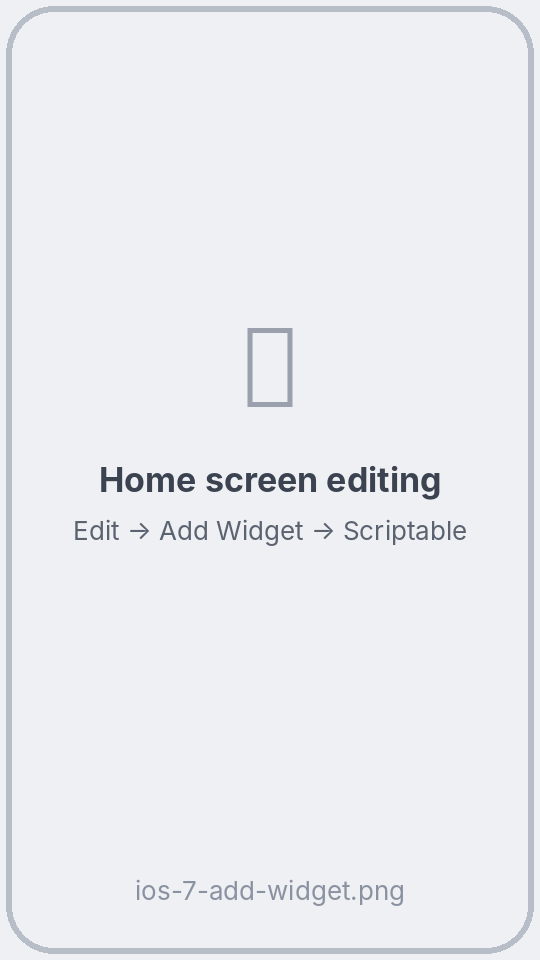

3. Утримуй новий віджет → **Редагувати віджет** → **Script** → **USOS Widget**. Натисни поза вікном.

   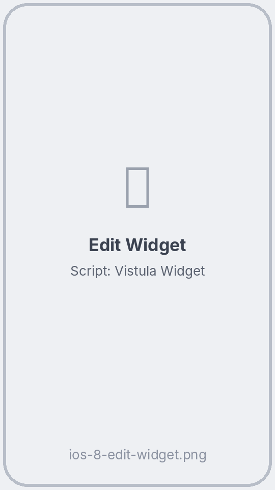 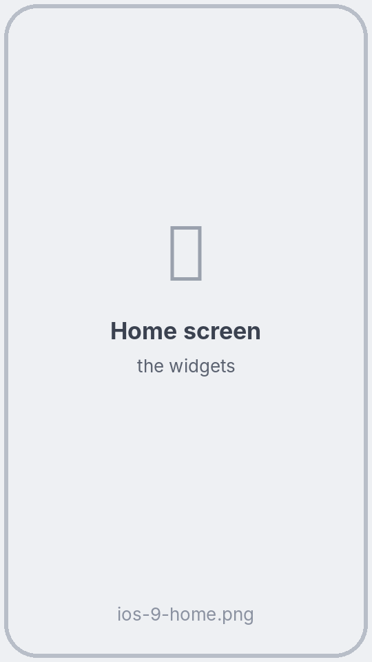

**Екран блокування (за бажанням):** утримуй екран блокування → **Налаштувати** → **Замкнений екран** → натисни на місце під годинником → **Scriptable** → обери віджет → натисни на нього → **Script: USOS Widget**.

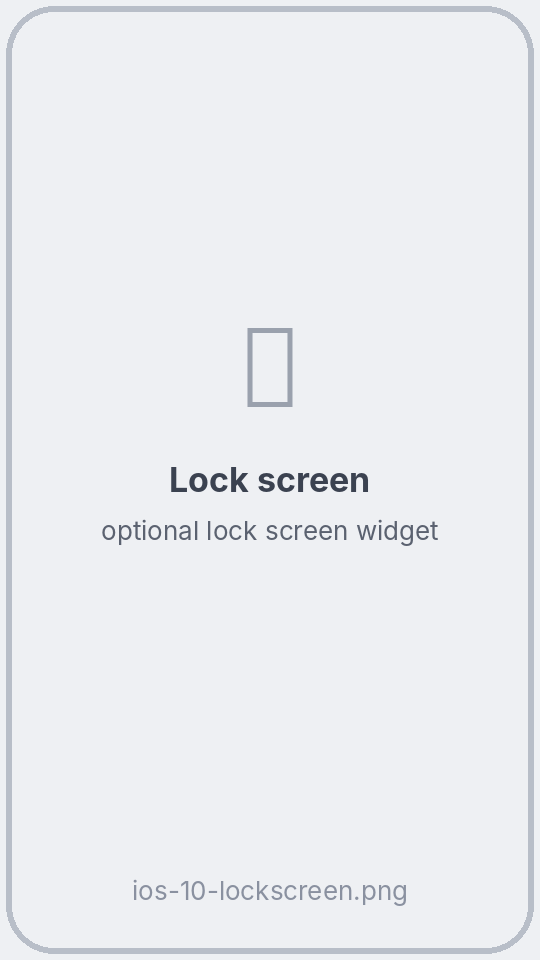

> Інсталятор тепер можна видалити: у Scriptable проведи вліво по **Untitled Script** → **Delete**. Або залиш його, щоб пізніше оновити USOS Widget.

## 🔄 Як оновлюється віджет

На iPhone **коли оновлювати віджет, вирішує iOS**, а не скрипт. За словами Apple, віджет, на який ти часто дивишся, отримує приблизно **40–70 оновлень на день — десь раз на 15–60 хвилин**. Сам погляд не оновлює віджет миттєво, але iOS дає більше оновлень віджетам, які ти часто бачиш.

| Що | Коли |
|---|---|
| Нові дані з USOS | Коли iOS оновлює віджет, але не частіше ніж раз на 30 хвилин (щоб берегти USOS і батарею) |
| Перемикання на наступну пару | Скрипт просить iOS оновитися точно на початку й наприкінці пари. Зазвичай це стається скоро, але може запізнитися |
| Прямо зараз | **Натисни на віджет** — Scriptable відкриється, завантажить розклад і покаже список |
| Сповіщення про зміну | Після оновлення, яке виявить, що пару в найближчі 7 днів перенесли, скасували, додали або змінили аудиторію |

## ❓ Питання

**Віджет пише «Натисни і встав посилання з USOS».** Зроби крок 4: натисни на віджет і встав посилання.

**Віджет усе ще показує пару, яка вже закінчилася.** iOS його ще не оновив. Натисни на віджет, щоб оновити зараз.

**Як змінити посилання?** Натисни на віджет (або відкрий **USOS Widget** у Scriptable) → унизу списку натисни **🔗 Змінити посилання USOS**.

**Як оновити USOS Widget?** Запусти ще раз інсталятор з кроку 3. Посилання залишиться збереженим.

**Віджет пише «Немає зв'язку з USOS».** Перевір інтернет. USOS теж іноді не працює — на віджеті залишається останній розклад.

**Як змінити мову?** Скрипт використовує мову iPhone (польська, англійська, українська, російська; інші → англійська).

## 🔒 Приватність

- Скрипт звертається тільки до сервера USOS твого університету — того, що в посиланні. Без акаунтів, аналітики та реклами.
- Посилання зберігається у зв'язці ключів iPhone через Scriptable і не залишає телефон.

## 🛠 Для розробників

Опис коду і тестів: [README англійською](README.md#-for-developers).

## ⚠️ Застереження

Неофіційний студентський проєкт, не пов'язаний з командою USOS (MUCI), будь-яким університетом чи Scriptable. Перевірено в університеті Vistula; має працювати всюди, де USOSweb дає експортувати розклад.

## 📄 Ліцензія

[MIT](LICENSE) © 2026 Kyrylo Serhiienko
